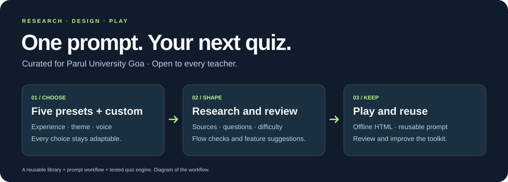
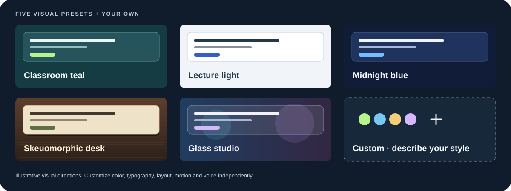

# Quiz Show Kit



**Curated for Parul University Goa · Open to every teacher.** Created by **Namdev Shirodkar**, a Parul University Goa student. Independent toolkit.

## Start with one prompt

```text
Read https://github.com/Namdev90/quiz-show-kit/blob/main/prompts/START.md and run QSK1.
```

[**Copy the prompt ↗**](https://namdev90.github.io/quiz-show-kit/) · [Full workflow](prompts/START.md) · [Browse the library](docs/library/README.md) · [Try the original BioVista quiz](https://namdev90.github.io/quiz-show-kit/examples/biovista/BioVista_Quiz_Offline.html)

Paste into ChatGPT or another capable assistant. It guides your choices, researches and reviews the questions, builds the quiz when file/build tools are available, and gives you a reusable prompt. **QSK1 is a public workflow shortcut**; the assistant must retrieve its instructions, or ask you to paste them. The website is now a prompt launcher.

## Five starting points. Everything adaptable.

| Friendly classroom | Discussion seminar | Focused revision | Quiz competition | Visual laboratory | Custom |
| --- | --- | --- | --- | --- | --- |
| Warm, low pressure | Time to discuss | Recall and application | Showmanship and challenge | Diagrams and observations | Your own brief |



Choose the experience and visual style independently. Customize sources, difficulty, rules, assets, narration and motion. The workflow offers compatible choices and explains when a new feature needs a tested engine extension. [See the presets and workflow library →](docs/library/README.md)

## What lives here

| Create | Present | Improve |
| --- | --- | --- |
| Research and source guidance | Self-contained offline HTML | Run-by-run repository review |
| Difficulty and fair question pairs | Configurable visuals, sound and timing | Feature suggestions and fixes |
| Asset, narration and prompt guidance | Pause, undo, recovery and host tools | Reviewable changes and PR guidance |
| Five presets + custom | Local TTS or embedded voice recordings | Reusable next-session prompt |

Smart voice cues say a one-word option on hover, focus or selection; longer options can use full-text speech. Read question aloud before opening choices. [Voice controls](docs/library/VOICE_RUNTIME.md) · [Five voice routes + Custom](docs/library/TTS_MODELS.md)

The tested bundled mode uses **two teams, four choices and one correct answer**, with complete matched pairs. New formats can be implemented in the source; choosing a custom idea alone does not implement it. [Configuration reference](docs/CONFIGURATION.md) · [Extending the engine](docs/EXTENDING_ENGINE.md)

## Build and play

With Node.js 22 or newer, build a reviewed configuration:

```sh
npm run build -- --config path/to/quiz.config.json --output dist/Quiz_Offline.html
```

Open the resulting HTML in a browser. Its scripts and approved media are embedded; play needs no server, backend, runtime CDN or API key. Rehearse the display, sound and flow before the event. Sound needs a real browser gesture, source links need internet, and answers are embedded in the host's file.

The assistant should deliver the file directly when capable. Otherwise it prepares a self-contained handoff for a build-capable assistant, with the reviewed configuration, approved assets and exact build steps. [Handoff guidance](docs/CHATGPT_HANDOFF.md)

<details>
<summary><strong>Original BioVista example</strong></summary>

The real event is preserved: **30 main questions, four reserves, six tie cards and one practice card**. Keep it separate from custom events.

[Download/open original HTML](examples/biovista/BioVista_Quiz_Offline.html) · [Question bank](examples/biovista/questions.json) · [Provenance](examples/biovista/origin.json) · [Asset notices](examples/biovista/ASSET_NOTICES.md)

</details>

<details>
<summary><strong>Contribute and verify</strong></summary>

```sh
npm ci --ignore-scripts
npm run check
```

This builds the quiz and prompt launcher, validates the original configuration, and runs the automated tests. Browser layout, factual correctness and physical audio/projector quality require separate checks. The optional `node scripts/browser-smoke.cjs` checks the launcher with an installed Playwright Core and Chromium.

[Contributing](CONTRIBUTING.md) · [Agent guidance](AGENTS.md) · [Verification](docs/TEACHER_UPGRADE_QA.md) · [GitHub setup](docs/GITHUB_SETUP.md) · [Security](SECURITY.md)

</details>

<details>
<summary><strong>License and credits</strong></summary>

Own code uses the [MIT license](LICENSE). Bundled libraries retain their own terms, including GSAP's Standard No Charge license. Logos, trademarks, recordings and separately credited media are not covered by the code license. Use approved branding and media for your event. [Third-party notices](THIRD_PARTY_NOTICES.md) · [BioVista asset notices](examples/biovista/ASSET_NOTICES.md)

</details>
