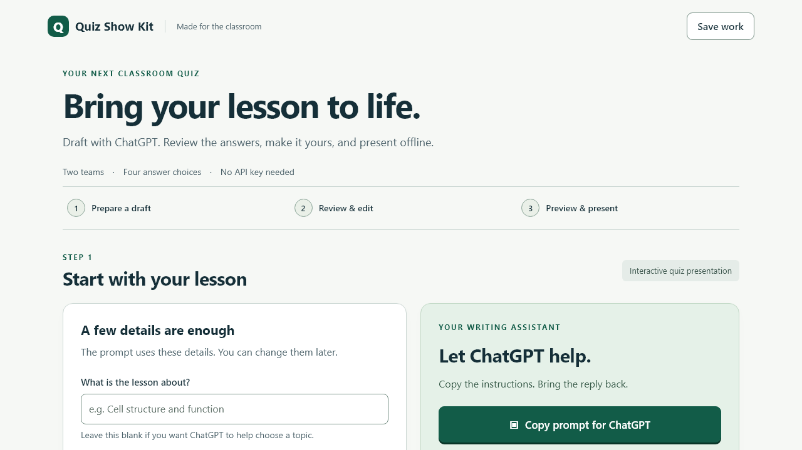
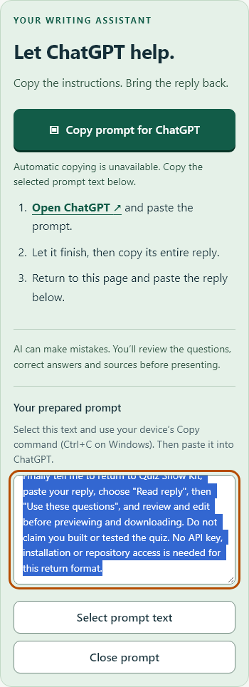

# Faculty builder verification

Verification date: 2026-10-13. The implementation was tested on the connected Windows computer with Node.js 24 and local headless Chromium 156. Browser checks use a representative reply built from the preserved example; an actual ChatGPT conversation was not run. The copied prompt's content and complete return contract were inspected and exercised through the importer.

`npm run check` builds the canonical quiz and both matching builder pages, validates the 41-card example, and passes 35 top-level tests. The engine test file includes its 22-case scoring/timing/recovery suite. Added regressions cover copy completion and repeated clicks, clipboard denial, import cancellation and input preservation, answer editing, preview/export, review reset, letter answer indices in existing banks, incomplete work recovery, bounded input, unsafe keys, SVG policy and invalid source dates.

The canonical build remains 4,035,414 bytes with SHA-256 `907e2242ddd7a3f8cdf839ae2bd7cf78c4257d8cc18e655856fc85691fb18317`. The engine, root BioVista configuration, assets and preserved example files were not changed.

All 18 actual browser scenarios passed. Checks cover clipboard read-back; a visible main-screen copy action at 1280×720; fenced reply import, Back and invalid input; edits retained in preview and the downloaded HTML; closing preview and returning focus; teacher-review reset; reload recovery; reopening the same file after cancel; original example import; local-file playback; denied-clipboard selection on mobile; editing and expanded controls at 320/390/768 pixels; mobile preview/export; keyboard focus and a complete keyboard authoring/export journey; and accessible names on every form control. No page script errors were observed in desktop authoring and preview.

## Reproduce browser checks

The optional `scripts/browser-smoke.cjs` uses an available Playwright Core installation and local Chromium. It is separate from the zero-install classroom builder and the normal `npm run check` dependencies. Set `QSK_PLAYWRIGHT_MODULE` to the installed module's absolute directory if it is not on Node's module path; set `QSK_BROWSER_EXECUTABLE` to a local Chromium executable when needed. Run `node scripts/browser-smoke.cjs` after `npm run build:builder`. The temporary localhost server closes after the checks, and downloads/screenshots/results are written under ignored `test-results/browser/`.

These checks are not a formal WCAG audit, a screen-reader usability study, factual approval of future AI output, a physical projector/speaker test or an event recording. Faculty should review content, verify sources and rehearse the exported file on their actual classroom equipment.
